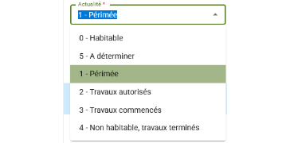

```{r setup, include=FALSE}
knitr::opts_chunk$set(echo = FALSE)
knitr::opts_chunk$set(cache = TRUE)
# Passer la valeur suivante à TRUE pour reproduire les extractions.
knitr::opts_chunk$set(eval = TRUE)
knitr::opts_chunk$set(warning = FALSE)
```


# Objet

Le service démocratie locale demande quelques chiffres, on repart du Ril millesime


```{r}
ril <- read.csv2("c:/Users/bmaranget/Documents/03_SIG/03_03_Data/11_RIL/ril_millesime_2025_93010.csv", fileEncoding = "UTF-8") 
table(ril$categorie)
table(ril$actualite)
# zéro habitatble
```




Spatialisation


```{r}
ril <- st_as_sf(ril, coords = c("x", "y"), crs = 2154)
# colonnes
names(ril)
ril <- ril [, c(4:8, 10:13)]
st_write(ril, "../data/ril.gpkg", "rilMillesime2025")
```


```{r}
library(sf)
ril <- st_read("../data/ril.gpkg", "rilMillesime2025", quiet=T)
knitr::kable(head(st_drop_geometry(ril)))
# type zéro logement habitable
ril <- ril [ril$actualite ==0,]
pop <- ril$nombre_logements*2
sum(pop, na.rm = T)
```


A 2 hbt par logement, on trouve 56 M hbts plus que le chiffre de population insee (55 M à 51 M environ, entre 2019 et 2023)

Correction 45.928 M en sélectionnant uniquement les habitables

# RIL 2025 par quartier


```{r}
quartier <- st_read("S:/VOIRIE PLANS/05_SIG/03_SOCLE/socle2026.gpkg")
quartier <- quartier [, c("nom")]
inter <- st_intersection(ril, quartier)
(tot <- aggregate(inter$nombre_logements, by = list(nom = inter$nom), sum, na.rm = T))
sum(tot$x)
```

Seulement 12 logements en NA, zéro dans le second cas

```{r}
pb <- inter [is.na(inter$nombre_logements),]
(joint <- merge(quartier, tot, by = "nom"))
st_write(joint, "../data/socle2026.gpkg", "quartierRIL", delete_layer = T)
write.csv(st_drop_geometry(joint), "../data/quartierRIL.csv", fileEncoding = "UTF-8")
```

