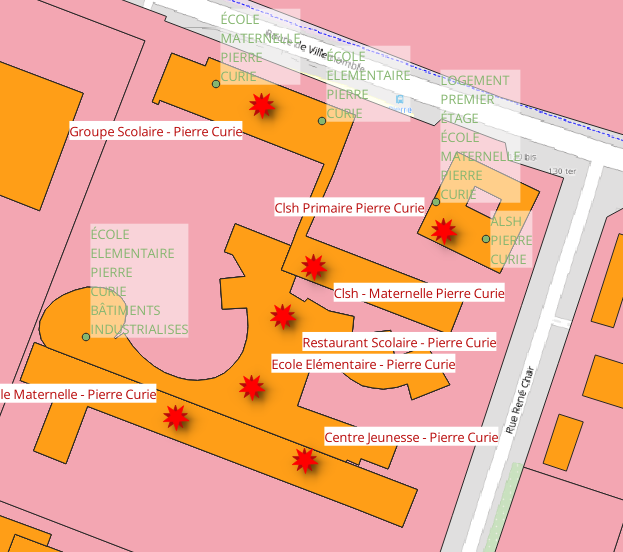

```{r setup, include=FALSE}
knitr::opts_chunk$set(echo = TRUE)
knitr::opts_chunk$set(cache = TRUE)
# Passer la valeur suivante à TRUE pour reproduire les extractions.
knitr::opts_chunk$set(eval = FALSE)
knitr::opts_chunk$set(warning = FALSE)
```


# Objet


Les bâtiments OpenGST sont nombreux, il s'agit de valider leurs
coordonnées géographiques.

On a 2 fichiers travaillés (comment ????) dans socle2026 et socle 2025 mais il semble y avoir des doublons.


## Librairies


```{r}
library(sf)
library(mapsf)
```

# fichiers openGST


```{r}
GST <- st_read("../data/socle2025.gpkg", "batOpenGST")
GST2 <- st_read("../data/socle2026copie.gpkg", "batOpenGST") 
```


# Exemple le sud de Bondy


32 points sur le collège P Curie

On relance un géocodage


```{r}
library(banR)
GST2$CODE_POSTAL <- 93140
GST2$VILLE <- 'Bondy'
GST2$adresse <- paste(GST2$Street2, GST2$Street, GST2$CODE_POSTAL, GST2$VILLE, sep = " ")
geoc <- geocode_tbl(tbl = GST2, adresse = adresse)
geoc <- geoc [!is.na(geoc$longitude),]
geoc <- st_as_sf(geoc, coords = c("longitude", "latitude"), crs = 4326)
st_write(geoc,"../data/bat.gpkg", "openGSTGeocode")
```


méthode proposée sur l'exemple Pierre CUrie, pts assurance et bâtiments





- vérification avec plan dessinateur

- rdv avec Corinne pour valider les choix


