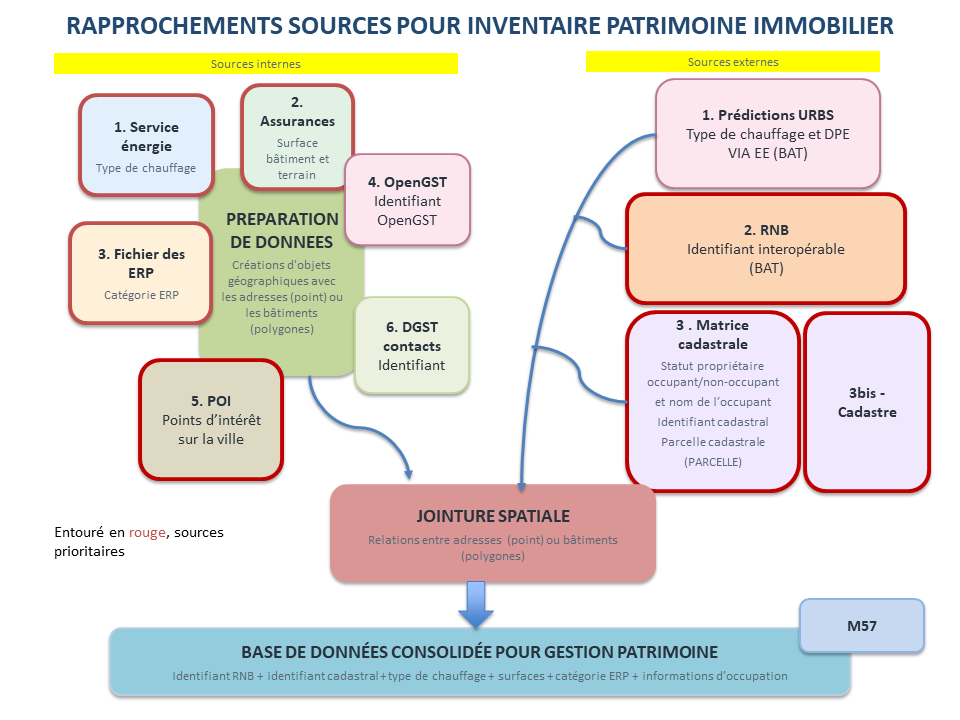
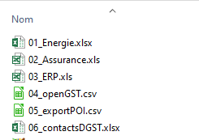
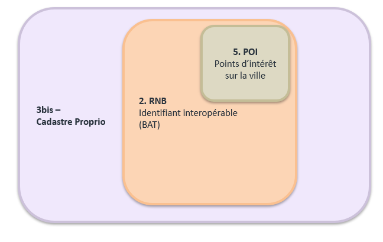
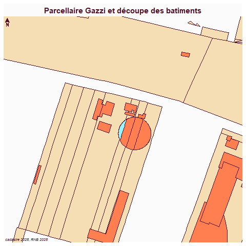
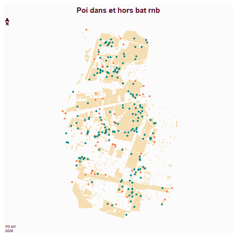
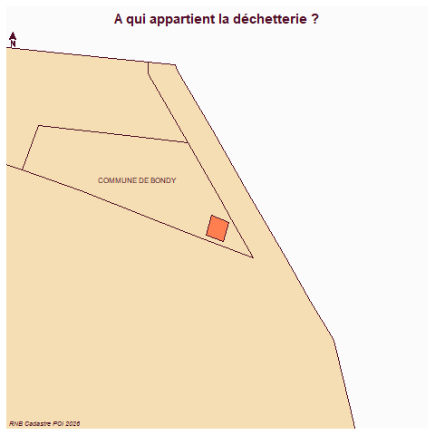
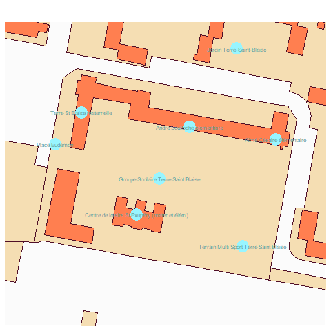
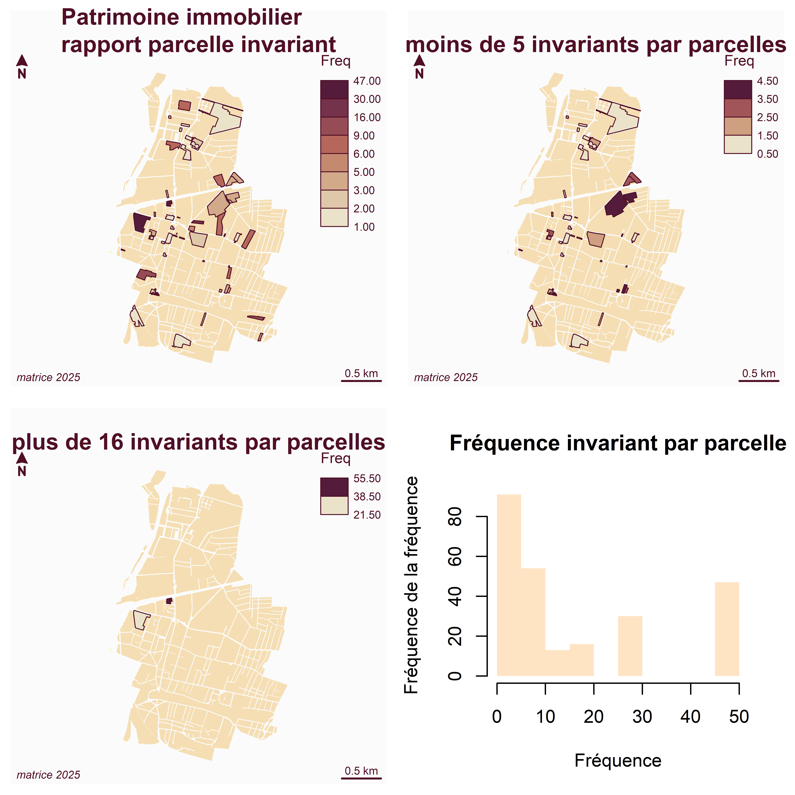
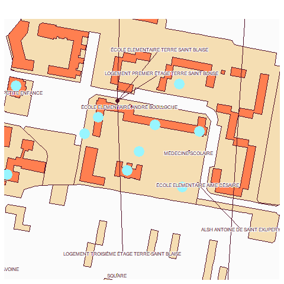

```{r setup, include=FALSE}
knitr::opts_chunk$set(echo = TRUE)
knitr::opts_chunk$set(cache = TRUE)
# Passer la valeur suivante à TRUE pour reproduire les extractions.
knitr::opts_chunk$set(eval = FALSE)
knitr::opts_chunk$set(warning = FALSE)
```


# Objet

Créer un inventaire du patrimoine réunissant plusieurs sources internes et externe permettant la gestion budgétaire M57


Validation des sources



La démarche est proposée en 2 temps

- recenser une base de bâtiments compléte (identifiant RNB / parcelle / poi) 


- pour ensuite ajouter les informations plus spécifiques (énergie, assurance, erp, contact)


```{r}
library(sf)
library(mapsf)
library(mapview)
library(rpostgis)
```


# base 

## 3 sources

On récupère RNB, cadastre (personne morale) et POI afin d'obtenir une première liste.

En effet, 

- le RNB inclue la totalité de la ville, 

- le cadastre personne morale toutes les parcelles dont la ville est propriétaire (attention 2 versions opendata et matrice)

- les POI, tous les bâtiments d'intérêt de la ville



### Cadastre

La ville n'est pas propriétaire des parcelles de tout son
patrimoine il s'agit donc d'indiquer le propriétaire et le gestionnaire pour tout ce
qui concerne la commune qu'elle soit propriétaire ou simple gestionnaire.


#### La ville propriétaire

```{r}
st_layers("../data/cadastre.gpkg")
pmorale <- st_read("../data/cadastre.gpkg", "pmorale")
table(pmorale$Groupe.personne...par)
pmorale <- pmorale [pmorale$Groupe.personne...par == "4 - Commune",]
ind <- grep ("BONDY", pmorale$Dénomination...par)
pmorale <- pmorale [ind,]
pmorale <- pmorale [, c("code", "Nature.voie", "Nom.voie", "N..voirie", "Indice.de.répétition")]
st_write (pmorale, "../data/finance.gpkg", "proprioBondy", delete_layer = T)
```

230 parcelles dont la ville est propriétaire qu'il faudra extraire

Mais il faut rajouter tous les équipements qui ne sont pas sur les parcelles propriétaires (voir intersection POI / pmorale) comme par exemple les crèches.


#### La ville gestionnaire


##### Une nouvelle base pour les personnes morales

On repart donc d'un fichier personnes morales s'étendant à tous 
les proprios


```{r}
cadastre <- st_read("../data/cadastre.gpkg", "pmorale")
pmorale <- st_read("../data/cadastre.gpkg", "pmoraleFusion")
```


De plus, ce fichier a fusionné les parcelles mitoyennes par propriétaire pour éviter le problème du stade Gazzi


###### Scission de parcelle : exemple Gazzi

données


problème batTot

```{r}
batTot <- st_read("../data/daf.gpkg", "batTot")
batTot <- st_transform(batTot, 4326) 
batTot <- batTot [st_is_valid(batTot$geom),]
library(units)
batTot$aire <- drop_units(st_area(batTot$geom))
batTot <- batTot [batTot$aire>0,]
batTot <- st_cast(batTot, "MULTIPOLYGON")
```


```{r}
bat <- st_read("../data/finance.gpkg", "batiment")
tournesol <- bat [bat$title == "Piscine Tournesol",]
tournesol$fid <- rownames(tournesol)
tournesol <- tournesol [tournesol$fid %in% c("844", "1118", "926","1240"),]
tournesol$fid
```


Cartographie

```{r}
png("../img/gazzi.png")
mf_init(st_buffer(tournesol, 100))
mf_map(cadastre, col = "wheat" ,add = T)
mf_map(bat, add = T, col = "coral")
mf_map(tournesol, add = T, col = "cadetblue1")
mf_layout("Parcellaire Gazzi et découpe des batiments", "cadastre 2026, RNB 2026")
dev.off()
```



### RNB

Récupération via un script basé sur l'API RNB

```{r}
rnb <- st_read("../data/RNB.gpkg", "rnb2026")
```

9848 bâtiments

### POI

Récupération via la base locale "bondy"

```{r}
conn <- RPostgreSQL::dbConnect(drv="PostgreSQL", dbname = "bondy", user="postgres", password="postgres")

pgPostGIS(conn)
pgListGeom(conn)
poi <- st_read(conn,   query = "select * from public.poi;")
dbDisconnect(conn)
```

239 poi


Récup en tt dans tt.gpkg (pas à jour avec la base)


```{r}
poi <- st_read("../data/tt.gpkg","poi")
poi <- st_transform(poi, 4326)
```


## Premières intersections


Projections

```{r}
st_crs(pmorale)
st_crs(poi)
st_crs(bat)
pmorale <- st_transform(pmorale,2154)
bat <- st_transform(bat, 2154)
```

intersection


d'abord le poi-parcelle, puis le bat et le poi-parcelle

```{r}
inter <- st_intersection(pmorale, poi)
# 197
# récupération géométrie parcelle
interSansGeom <- st_drop_geometry(inter)
jointure <- merge(pmorale [,"code"], interSansGeom,  by = "code")
```

le bat

```{r}
inter2 <- st_intersection(jointure, st_centroid(rnb))
# 1374
```


Récupération de la géométrie bat


```{r}
inter2 <- st_drop_geometry(inter2)
jointure <- merge(rnb [,"id"], inter2, by ="id")
```


enregistrement


```{r}
names(jointure)
jointure <- jointure [, c(1:9, 15)]

```

1374 bat doublons - pb de géométrie


```{r}
summary(jointure$geom)
jointure <- jointure [st_is_valid(jointure$geom),]
library(units)
jointure$aire <- drop_units(st_area(jointure$geom))
jointure <- jointure [jointure$aire>0,]
jointure <- st_cast(jointure, "MULTIPOLYGON")
st_write(jointure,"../data/finance.gpkg", "batiment", delete_layer = T)
```


1370

## Vérifications

On a une base de 1374 bâtiments comment la vérifier ?

Plusieurs possibilités

### POI avant après

Les poi de départ sont en rouge (234)

Les 130 poi dans des bâtiments sont en bleu

```{r}
png("../img/poiRNB.png")
mf_map(cadastre, col =  "wheat", border = NA)
mf_map(poi, add = T, col = "coral")
mf_map(inter, add = T, col = "cyan4")
mf_layout("Poi dans et hors bat rnb", "rnb poi\n2026")
dev.off()
```




TODO vérifier les POI verts => base des bâtiments publics

TODO vérifier les POI rouge => hors bâtiments publics

exemple : à qui appartient la déchetterie ? 

```{r}
png("../img/decheterie.png")
bat [bat$title == "Déchèterie de Bondy", ]
mf_init(st_buffer(dechet, 40))
mf_map(pmorale, col = "wheat", add = T)
mf_map(dechet, col = "coral", add = T)
mf_label(pmorale, var = "Dénomination...par", overlap = F)
mf_layout("A qui appartient la déchetterie ?", "RNB Cadastre POI 2026")
dev.off()
```





### POI absents


Parcelle par parcelle, on vérifie les bâtiments mal nommés

exemple : Jean Zay, il manque le réfectoire


```{r}
bat <- st_read("../data/finance.gpkg", "batiment")
jz <- pmorale [pmorale$code == "A301",]
png("../img/jz.png")
mf_init(st_buffer(jz, 10))
mf_map(pmorale, add = T, col = "wheat")
mf_map(jointure, col = "coral", add = T)
mf_map(poi, col = "cadetblue1", add = T,  cex = 5)
mf_label(poi, var ="title", col = "cadetblue")
dev.off()
```




procédure : rajout du POI / puis nouvelle intersection


TODO vérif complète


### Bâtiments hors parcelles : y-a-t-il des bâtiments publics hors parcelle personne morale ?

Certains bâtiments publics hors parcelle personnes morales ?


TODO ?


# Jointures avec autres fichiers

A savoir : 

- la matrice => récupération d'invariant

- les assurances

- les ERP => catégorie d'ERP

- énergie => type de chauffage


## Matrice : parcelle ou adresse ?

L'export se fait sous Arcopole avec l'outil filtre parcelle / personne morale

Attention, il s'agit des biens fonciers communaux asujettis à l'impôt !

Il n'y a par exemple pas de référence à la personne mairie


### Jointure est faite à la parcelle


```{r}
matrice <- read.csv2("../data/finances.csv", na.strings = "-")
# 2524 c'est trop, en fait export de tous les proprios des parcelles concernées
matrice <- matrice [matrice$Propriétaires == "COMMUNE DE BONDY",]
# 251
surf <- matrice$Surface.d.habitation..m..
hist(surf)
sel <- matrice [matrice$Surface.d.habitation..m.. > 150,]
sel [1,]
surf <- matrice$Surface.commerciale.ou.industrielle..m..
hist(surf)
sel <- matrice [matrice$Surface.commerciale.ou.industrielle..m.. > 500 & !is.na(matrice$Surface.commerciale.ou.industrielle..m..) ,]
sel$Adresse.complète
```

Surface commerciale correspond aux bâtiments publics ?


```{r}
# pas de surface d'habitation correspondant à gros terrain
# pour récupérer la géométrie parcelle on charge le cadastre propro
cadastre <- st_read("../data/cadastre.gpkg", "proprio", quiet = T)
matrice$code <- gsub("930010| +", "", matrice$Numéro.parcelle)
table(matrice$code)
cadastre$code
jointure <- merge(cadastre, matrice, by ="code")
mf_map(jointure)
ref <- as.data.frame( table(jointure$code))
jointure <- merge(jointure, ref, by.x= "code", by.y="Var1")
length(unique(jointure$code))
```

251 invariants sur 59 parcelles


```{r}
png("../img/invariantParcelle.png", width = 6000, height = 6000, res = 1000)
par(mfrow = c(2,2))
mf_map(cadastre, col = "wheat", border = NA)
mf_map(type = "choro", jointure, var ="Freq", add = T)
mf_layout("Patrimoine immobilier\nrapport parcelle invariant", "matrice 2025")
sel <- jointure [jointure$Freq < 5,]
mf_map(cadastre, col = "wheat", border = NA)
mf_map(sel, type = "choro", var ="Freq", add = T)
mf_layout("\nmoins de 5 invariants par parcelles", "matrice 2025")
sel <- jointure [jointure$Freq > 20,]
mf_map(cadastre, col = "wheat", border = NA)
mf_map(sel, type = "choro", var ="Freq", add = T)
mf_layout("\nplus de 16 invariants par parcelles", "matrice 2025")
hist(jointure$Freq, xlab = "Fréquence", ylab = "Fréquence de la fréquence", main = "Fréquence invariant par parcelle", col = "bisque1", border = NA)
dev.off()
```

Quelques exemples 


```{r}
# 90 av Galliéni
table(jointure$adresse [jointure$Freq == 47])
# La Bruyère
res <- jointure [jointure$code == "L0134",]
res
# ¨Pasteur
res <- jointure [jointure$code == "L0045",]
res
```




```{r}
jointure$fid <- row.names(jointure)
jointure$fid <- as.integer(jointure$fid)
st_write(jointure, "../data/finance.gpkg", "cadastreProprioInvariant", delete_layer = T )
```


### Jointure à l'adresse


####  Assurances

```{r}
assurance <- read.csv("../data/finances/02_Asurance.csv")
library(banR)
assurance$adresse <- paste(assurance$NUMÉRO_VOIE, assurance$LIBELLE_VOIE, assurance$CODE_POSTAL, assurance$VILLE, sep = " ")
geoc <- geocode_tbl(tbl = assurance, adresse = adresse)
geoc <- geoc [!is.na(geoc$longitude),]
geoc <- st_as_sf(geoc, coords = c("longitude", "latitude"), crs = 4326)
st_write(geoc,"../data/finance.gpkg", "assurance")
```


175 sur 176 géocodé


Cartographie


```{r}
png("../img/geoLocAssurance.png")
mf_init(st_buffer(jz, 70))
mf_map(pmorale, add = T, col = "wheat")
mf_map(bat, col = "coral", add = T)
mf_map(poi, col = "cadetblue1", add = T,  cex = 5)
mf_map(geoc, add = T, cex = 2)
names(geoc)
mf_label(geoc, halo = T,var ="DÉSIGNATION_BÂTIMENT", overlap = F)
dev.off()
```





### Energie


### ERP


### OpenGST


### Jointure au poi impossible ?