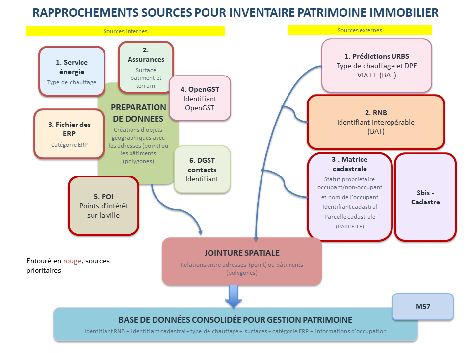
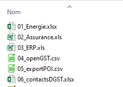
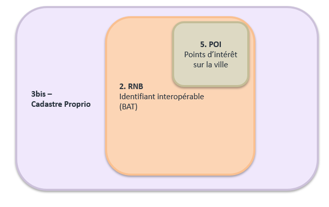
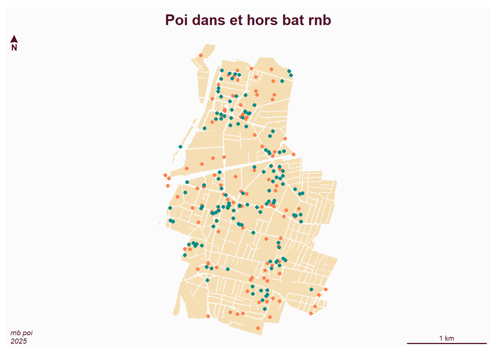
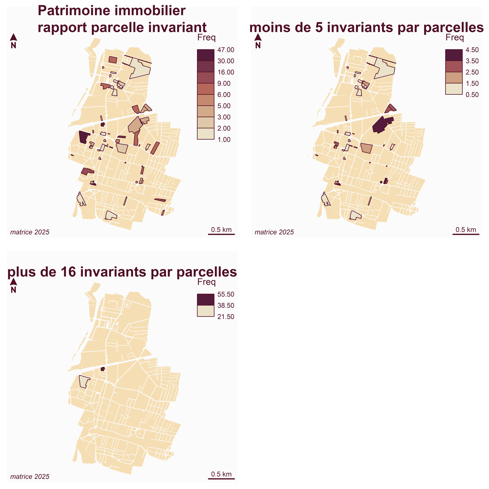

```{r setup, include=FALSE}
knitr::opts_chunk$set(echo = FALSE)
knitr::opts_chunk$set(cache = TRUE)
# Passer la valeur suivante à TRUE pour reproduire les extractions.
knitr::opts_chunk$set(eval = FALSE)
knitr::opts_chunk$set(warning = FALSE)
```


# Objet

Créer un inventaire du patrimoine réunissant plusieurs sources internes et externe permettant la gestion budgétaire M57


Validation des sources



La démarche est proposée en 2 temps

- recenser une base de bâtiments compléte (identifiant RNB / parcelle / poi) 


- pour ensuite ajouter les informations plus spécifiques (énergie, assurance, erp, contact)


```{r}
library(sf)
library(mapsf)
library(mapview)
library(rpostgis)
```


# base 

## 3 sources

On récupère RNB, cadastre (personne morale) et POI afin d'obtenir une première liste.

En effet, 

- le RNB inclue la totalité de la ville, 

- le cadastre personne morale toutes les parcelles dont la ville est propriétaire (attention 2 versions opendata et matrice)

- les POI, tous les bâtiments d'intérêt de la ville



### Cadastre


```{r}
pmorale <- st_read("../data/cadastre.gpkg", "pmorale")
table(pmorale$Groupe.personne...par)
pmorale <- pmorale [pmorale$Groupe.personne...par == "4 - Commune",]
ind <- grep ("BONDY", pmorale$Dénomination...par)
pmorale <- pmorale [ind,]
pmorale <- pmorale [, c("code", "Nature.voie", "Nom.voie", "N..voirie", "Indice.de.répétition")]
st_write (pmorale, "../data/finance.gpkg", "proprioBondy", delete_layer = T)
```

230 parcelles

### RNB

Récupération via un script basé sur l'API RNB

```{r}
bat <- st_read("../data/RNB.gpkg", "rnb2026")
```

9848 bâtiments

### POI

Récupération via la base locale "bondy"

```{r}
conn <- RPostgreSQL::dbConnect(drv="PostgreSQL", dbname = "bondy", user="postgres", password="postgres")
pgPostGIS(conn)
pgListGeom(conn)
poi <- st_read(conn,   query = "select * from public.poi;")
dbDisconnect(conn)
```

239 poi


## Intersections


Projections

```{r}
st_crs(pmorale)
st_crs(poi)
st_crs(bat)
pmorale <- st_transform(pmorale,2154)
bat <- st_transform(bat, 2154)
```

intersection


d'abord le poi, puis le bat

```{r}
inter <- st_intersection(pmorale, poi)
# 151
inter2 <- st_intersection(bat, inter)
# 93
```


Récupération de la géométrie bat


```{r}
inter2 <- st_drop_geometry(inter2)
jointure <- merge(bat, inter2, by ="id")
```


enregistrement


```{r}
names(jointure)
jointure <- jointure [, c(1, 12, 13:16, 20,  18,19,27 ,28)]
st_write(jointure,"../data/daf.gpkg", "batiment", delete_layer = T)
```


## Vérifications

On a une base de 93 bâtiments comment la vérifier ?

Plusieurs possibilités

### POI avant après

Les poi de départ sont en reouge (234)

Les 130 poi dans des bâtiments sont en bleu

```{r}
png("../img/poiRNB.png")
mf_map(cadastre, col =  "wheat", border = NA)
mf_map(poi, add = T, col = "coral")
mf_map(inter, add = T, col = "cyan4")
mf_layout("Poi dans et hors bat rnb", "rnb poi\n2025")
dev.off()
```




TODO vérifier les POI verts => base des bâtiments publics

TODO vérifier les POI rouge => hors bâitments publics

exemple : à qui appartient le cimetière ? 


### Bâtiments parcelles pas dans POI


```{r}
inter <- st_intersection(bat, pmorale)
st_write(inter, "../data/daf.gpkg", "batTot")
```

Il manque la loge stade Curie, le gymnase Aïache...


TODO vérif complète

### Bâtiments hors parcelles

De plus certains bâtiments appartiennent à la ville mais pas sur parcelle pmorale


TODO ?


# Jointures avec autres fichiers

A savoir : 

- la matrice => récupération d'invariant

- les ERP => catégorie d'ERP

- énergie => type de chauffage


## Matrice : parcelle ou adresse ?

L'export se fait sous Arcopole avec l'outil filtre parcelle / personne morale

Attention, il s'agit des biens fonciers communaux asujettis à l'impôt !


### Jointure est faite à la parcelle


```{r}
matrice <- read.csv2("../data/finances.csv")
# 2524 c'est trop, en fait export de tous les proprios des parcelles concernées
matrice <- matrice [matrice$Propriétaires == "COMMUNE DE BONDY",]
# 251
surf <- matrice$Surface.d.habitation..m..
# pas de surface d'habitation correspondant à gros terrain
# pour récupérer la géométrie parcelle on charge le cadastre propro
cadastre <- st_read(conn, query = "select * from cadastre.proprio2025", quiet = T)
dbDisconnect(conn)
matrice$code <- gsub("930010| +", "", matrice$Numéro.parcelle)
table(matrice$code)
cadastre$code
jointure <- merge(cadastre, matrice, by ="code")
mf_map(jointure)
ref <- as.data.frame( table(jointure$code))
jointure <- merge(jointure, ref, by.x= "code", by.y="Var1")
length(unique(jointure$code))
```

251 invariants sur 59 parcelles


```{r}
png("../img/invariantParcelle.png", width = 6000, height = 6000, res = 1000)
par(mfrow = c(2,2))
mf_map(cadastre, col = "wheat", border = NA)
mf_map(type = "choro", jointure, var ="Freq", add = T)
mf_layout("Patrimoine immobilier\nrapport parcelle invariant", "matrice 2025")
sel <- jointure [jointure$Freq < 5,]
mf_map(cadastre, col = "wheat", border = NA)
mf_map(sel, type = "choro", var ="Freq", add = T)
mf_layout("\nmoins de 5 invariants par parcelles", "matrice 2025")
sel <- jointure [jointure$Freq > 20,]
mf_map(cadastre, col = "wheat", border = NA)
mf_map(sel, type = "choro", var ="Freq", add = T)
mf_layout("\nplus de 16 invariants par parcelles", "matrice 2025")
```


```{r}
hist(jointure$Freq, xlab = "Fréquence", ylab = "Fréquence de la fréquence", main = "Fréquence invariant par parcelle", col = "bisque1", border = NA)
dev.off()
# 90 av Galliéni
table(jointure$adresse [jointure$Freq == 47])
table(jointure$adresse [jointure$Freq == 47])
# La Bruyère
res <- jointure [jointure$code == "L0134",]
res
# ¨Pasteur
res <- jointure [jointure$code == "L0045",]
res
```




```{r}
jointure$fid <- row.names(jointure)
jointure$fid <- as.integer(jointure$fid)
st_write(jointure, "../data/finance.gpkg", "cadastreProprioInvariant", delete_layer = T )
```


### Jointure à l'adresse

Dans le fichier matrice, il existe une adresse.


## Autres jointures à l'adresse


### Energie


### ERP


### OpenGST


### Jointure au poi impossible ?